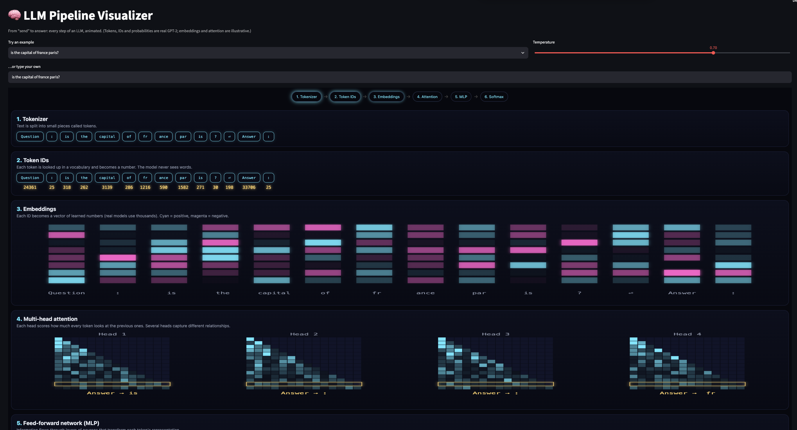
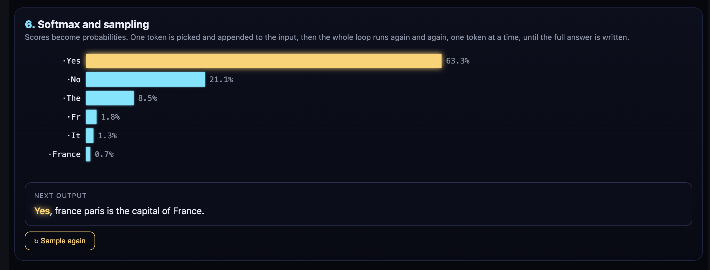

# 🧠 LLM Pipeline Visualizer

**See what happens between hitting "send" and an LLM's answer.**
An interactive Streamlit app that walks through every step of text generation, from tokenization to sampling, using a real GPT-2 model.



## ✨ What it shows

Type any question (or pick an example) and watch it flow through the pipeline:

| Step | What happens |
|------|--------------|
| **1. Tokenizer** | Text is split into small pieces called tokens |
| **2. Token IDs** | Each token becomes a number. The model never sees words |
| **3. Embeddings** | Each ID becomes a vector of learned numbers |
| **4. Multi-head attention** | Each token scores how much it "looks at" the previous ones |
| **5. Feed-forward network (MLP)** | Layers of neurons transform each token's representation |
| **6. Softmax and sampling** | Scores become probabilities, one token is drawn, and the loop repeats until the answer is complete |

The **temperature** slider changes the probabilities live: at `0` the model always picks the most likely token, and as it rises, less likely tokens get a chance.



> 💡 **Key insight:** an LLM doesn't write the answer all at once. It predicts one token at a time, and every token is a full pass through the network. That's why longer answers take longer to generate.

## 🔍 What's real and what's illustrative

| Part | Source |
|------|--------|
| Tokens and token IDs | ✅ Real GPT-2 tokenizer |
| Next-token probabilities (step 6) | ✅ Real GPT-2 logits, softmax with your temperature |
| Generated answer | ✅ Real GPT-2 generation, token by token |
| Embedding colors (step 3) | 🎨 Illustrative |
| Attention heatmaps (step 4) and MLP animation (step 5) | 🎨 Illustrative |

Real GPT-2 uses 768-dimensional embeddings, 12 layers and 12 attention heads per layer. The visuals simplify this so the idea is easy to see.

## 🚀 Quick start

```bash
git clone https://github.com/hajar365/llm-pipeline-visualizer.git
cd llm-pipeline-visualizer
python -m venv .venv
source .venv/bin/activate        # Windows: .venv\Scripts\activate
pip install -r requirements.txt
streamlit run app.py
```

The first run downloads GPT-2 (about 500 MB). After that it's cached.

## 🧩 How it works

- **`app.py`** loads GPT-2 with Hugging Face Transformers, runs the real tokenizer and model, and applies temperature with `softmax(logits / T)`. It sends the results to the page as JSON.
- **`pipeline.html`** draws the animated visuals on HTML canvases (glowing embeddings, attention heatmaps, an MLP with traveling pulses, animated probability bars and a typewriter output).

### A note on the prompt

GPT-2 is a text-completion model, not a chat model, so it needs a format to follow. The app wraps your question as `Question: … Answer:` and prepends a few hidden example Q&A pairs, so GPT-2 answers instead of rambling. Chat apps do the same thing with hidden system prompts. The tokens you see in steps 1 and 2 are the visible part of the prompt only.

## ⚠️ Limitations

- GPT-2 is small (2019). Answers to open-ended questions can be odd, repetitive or wrong. That's expected, and it makes the sampling randomness easy to see.
- Each new question or temperature value generates 6 candidate answers, so it can take a few seconds on CPU.

## 🛣️ Roadmap

- [ ] Real attention weights from the model (`output_attentions=True`)
- [ ] Real embeddings for the input tokens
- [ ] Optional instruction-tuned model (for example Qwen2.5-0.5B-Instruct) for better answers
- [ ] Top-k and top-p sampling controls

## 🛠️ Built with

Python · Hugging Face Transformers · PyTorch · Streamlit · HTML Canvas

## 📄 License

MIT